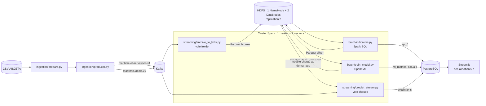

# Architecture



## Conteneurs

| Service | Image | Rôle | Port local |
|---|---|---|---|
| `kafka` | apache/kafka:3.9.1 | Broker KRaft, 3 partitions par topic, volume persistant | 29092 |
| `kafka-init` | apache/kafka:3.9.1 | Crée les deux topics puis s'arrête | |
| `namenode` | bde2020/hadoop-namenode (Hadoop 3.2.1) | Métadonnées HDFS | 9870 (interface web) |
| `datanode1`, `datanode2` | bde2020/hadoop-datanode | Blocs HDFS, un volume persistant chacun | |
| `spark-master` | port-eta/spark:3.5.3 | Master standalone | 8080 |
| `spark-worker-1`, `spark-worker-2` | port-eta/spark:3.5.3 | Executors (2 cœurs, 1,4 Go chacun) | 8081, 8082 |
| `postgres` | postgres:16.4-alpine | Base de restitution | 55432 |
| `dashboard` | port-eta/dashboard:1.0 | Streamlit | 8501 |
| `stream-archive` (profil `streaming`) | port-eta/spark:3.5.3 | Driver de la voie froide | |
| `stream-predict` (profil `streaming`) | port-eta/spark:3.5.3 | Driver de la voie chaude | |
| `batch` (profil `batch`) | port-eta/spark:3.5.3 | Driver des jobs batch ponctuels | |
| `ingestion`, `hdfs` (profil `tools`) | python:3.11 / client Hadoop | Outils en ligne de commande | |

Les drivers tournent en mode client dans leur propre conteneur et soumettent le travail au master `spark://spark-master:7077` : tous les calculs s'exécutent sur les deux workers.

## Organisation des données dans HDFS

```
/data/bronze/observations/event_date=2020-07-10/part-*.parquet   flux brut archivé (avec rejeux)
/data/bronze/labels/event_date=.../
/data/silver/observations/event_date=.../                        dédoublonné sur event_id
/data/silver/labels/event_date=.../
/models/eta/v20261127T101500Z/                                   PipelineModel versionné
/models/eta/current/                                             version servie au streaming
/models/eta/current_version/                                     nom de la version servie
/checkpoints/archive_observations, archive_labels, predict_eta   offsets Kafka validés
```

## Garanties de reprise

- **Archivage** : le checkpoint mémorise les offsets Kafka. Le sink fichier de Spark écrit chaque micro-batch une seule fois (journal `_spark_metadata`).
- **Prédiction** : après un arrêt, Spark rejoue le dernier micro-batch non validé. Les lignes passent par une table de transit puis `INSERT ... ON CONFLICT (event_id) DO NOTHING`, donc aucun doublon.
- **Rejeu du producteur** : un même événement garde son `event_id`. La couche silver ne garde qu'une ligne par `event_id`.
